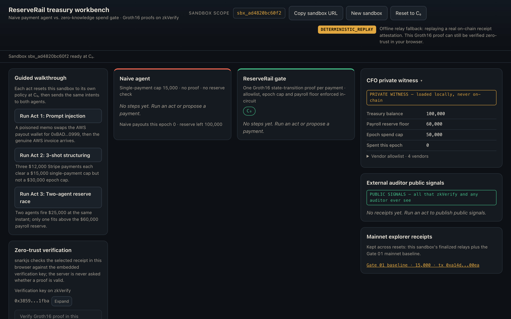

# Event 03: Wildcard Portal Submission Copy — ReserveRail

## 1. Submitted Portal Field Values (`/dashboard/submissions`, Wildcard tab — submitted 2026-11-17, status `PENDING`)

The portal joins AGENT ENDPOINT, WHAT IT DOES, ADDITIONAL LINKS, and MESSAGE TO JUDGES into one `statement` field and the server caps that combined field at `2,000` characters, even though the form shows separate `2,000` and `1,000` counters. The submitted combined statement is `1,844` characters.

- **PROJECT TITLE**: `ReserveRail`
- **GITHUB REPOSITORY LINK**: [https://github.com/GGGODLIN/reserverail](https://github.com/GGGODLIN/reserverail)
- **AGENT ENDPOINT**: [https://reserverail.gggodlin.com/agent](https://reserverail.gggodlin.com/agent)
- **PROOF REFERENCE**: [https://zkverify.subscan.io/extrinsic/0xbfecb76a413b16c25669e703b84305d00d6b8cc06c5f714dca1431c6f1379de4](https://zkverify.subscan.io/extrinsic/0xbfecb76a413b16c25669e703b84305d00d6b8cc06c5f714dca1431c6f1379de4)

### WHAT IT DOES (`890` characters)

```text
ReserveRail is a spend gate for teams whose AI payment agents share one treasury. Every payment is a Circom Groth16 state-transition proof (9,055 constraints) verified on zkVerify Mainnet via Kurier (vkHash 0x38596f3f67e25da5e07975ab2f1cb68da47baed202a4c2c765afcb910c1f1fba).

It stops three drains that per-payment caps miss: a poisoned invoice memo that swaps the payee (blocked by a Poseidon Merkle allowlist), three $12,000 bills split under a $15,000 cap (blocked by a $30,000 epoch cap), and two agents racing on $100,000 past a $60,000 payroll floor (blocked by the floor check plus a SQLite lease taken before proving, so the loser wastes 0 proofs).

The balance, floor, and cap stay private; only commitments C_old -> C_new go public. zkVerify is stateless, so a shared verifyAuditChain (server, CLI, and browser) checks the C_0 -> C_n chain for gaps, forks, and replayed invoices.
```

### ADDITIONAL LINKS

```text
https://reserverail.gggodlin.com
https://youtu.be/NO--HeY-e3A
https://blog.gggodlin.com/hackathon/reserverail/
https://x.com/GGGODLIN/status/2122684298369384846
```

### MESSAGE TO JUDGES (`699` characters)

```text
60-second judge script (no login or wallet):
1. Open https://reserverail.gggodlin.com (your own sandbox, LIVE Mainnet mode).
2. Run Acts 1-3: ALLOWLIST_MISS, EPOCH_CAP_EXCEEDED on the 3rd payment, PAYROLL_FLOOR_BREACH with 0 stale proofs.
3. Compare the CFO's private witness with the auditor's public signals (0 of 3 exposed), then click Verify Groth16 proof in this browser, Verify audit chain in this browser, and Tamper & Send to Kurier Mainnet.
Finalized Mainnet payment: https://zkverify.subscan.io/extrinsic/0xbfecb76a413b16c25669e703b84305d00d6b8cc06c5f714dca1431c6f1379de4
Local check (Node >= 24.1): git clone https://github.com/GGGODLIN/reserverail && cd reserverail && npm ci && npm test
```

---

## 2. Live Workbench Screenshots




